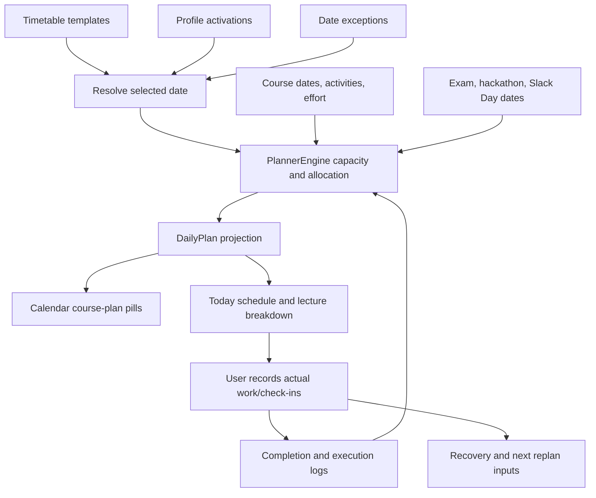

<div align="center">
  

  <h1>SARTHI</h1>
  <p><strong>Personal Execution &amp; Student Operating System</strong></p>
  <p>Plan with intent. Execute the next step. Adapt when life changes.</p>

  <p>
    
    
    
    
  </p>
</div>

---

## On this page

- [The idea and product modules](#the-idea)
- [Page guide](#page-guide)
- [Core execution workflows](#core-execution-workflows)
- [Domain concepts and persistence](#domain-concepts-and-invariants)
- [Frontend and backend architecture](#frontend-architecture)
- [API route map](#api-route-map)
- [Local development and configuration](#local-development)
- [Tests and deployment](#engineering-workflow-and-test-map)
- [Security and troubleshooting](#security-and-privacy)

## The idea

SARTHI brings a student's plans, learning, academic responsibilities, projects, routines, and progress into one connected workspace.

Most productivity tools are good at storing tasks. SARTHI is built around the harder part: choosing what can realistically happen today, recording what actually happened, and making a workable next plan when the day changes.

> A disrupted day should lead to a better next step, not an impossible backlog.

The product connects three parts of execution:

1. **Plan** around priorities, deadlines, effort, available time, and fixed commitments.
2. **Execute** through focused sessions, task check-ins, learning activities, and real progress records.
3. **Adapt** with bounded recovery and a visible replan that the user can review and confirm.

## What is in the application

| Workspace | What it supports |
| --- | --- |
| **Today** | A daily execution view that brings planned tasks, schedule context, progress, and the next useful action together. |
| **Tasks & backlog** | Create and prioritise work, record partial effort, complete or defer tasks, and keep unfinished work from silently becoming an unlimited catch-up queue. |
| **Adaptive Planner** | Review available capacity, replan remaining work, use recovery options, and confirm the proposed changes. |
| **Timetable & Calendar** | Manage schedule templates, versions, exceptions, conflicts, and date-based views of work. |
| **Courses Hub** | Create courses, import structured curriculum, preview import changes, and track progress across a nested curriculum. |
| **Exploration Lab** | Maintain independent learning tracks and activities alongside formal courses. |
| **Course Tracker** | Work through activities, record effort, and keep completion in sync with the course roadmap. |
| **DSA & Web Development** | Dedicated learning workspaces for problem-solving and web development curricula. |
| **Focus Timer** | Start, pause, resume, complete, and review focus sessions. |
| **Academics** | Track subjects, attendance, assignments, exams, preparation dates, and exam mode. |
| **Hackathons & Projects** | Organise events, stages, milestones, submissions, status changes, and notifications. |
| **Reading** | Organise reading phases and books, log sessions, and review progress. |
| **Oratory** | Manage public-speaking practice and weekly progress. |
| **Habits & Fitness** | Record routines, fitness activity, and dated measurements. |
| **Journal, Notes & Reset Room** | Keep personal reflections and notes, and use a short recovery workflow to choose a manageable next action. |
| **Evidence Locker** | Record evidence and milestones that support personal progress reviews. |
| **Rewards & Savings** | Track user-defined rewards, savings targets, and contributions. |
| **Share Market Education** | Explore market concepts and record paper-trading activity without connecting a brokerage account. |
| **Analytics & Settings** | Review execution summaries, manage preferences, inspect integration configuration, and export account data. |

The navigation is data-aware: active courses and explorations can appear as direct links, and completed tracks are removed from the active navigation list.

## Page guide

Every browser screen lives in `client/pages/`. The app is intentionally a set of HTML pages sharing a common navigation shell and ES-module helpers, rather than a single-page framework.

| Page | Purpose |
| --- | --- |
| `intro.html` | Animated entry experience; its Skip control and timed completion lead to login. |
| `login.html` | Sign in and account creation. |
| `dashboard.html` | Today: selected-date schedule, allocated work, execution controls, completion history, daily reflection, and routine/habit check-ins. |
| `calendar.html` | Month view combining stored course plans with exams, preparation dates, assignments, tasks, exceptions, hackathons, and Slack Days. Selecting a date opens its detailed inspector; a date can also be opened in Today. |
| `timetable.html` | Recurring weekday/Saturday/Sunday templates, named profiles, date-range activations, custom blocks, exceptions, and conflict checks. |
| `planner.html` | Workload and recovery review, replan proposal, Slack Day request, and explicit proposal confirmation. |
| `tasks.html` | General tasks and backlog management, including partial effort and deferral. |
| `courses.html` | Course hub, course metadata, curriculum import preview/diff/commit, and progress overview. |
| `tracker.html` | Dedicated course or exploration curriculum tracker, selected by URL context. |
| `explore.html` | Independent exploration tracks and activities. |
| `dsa.html`, `webdev.html` | Dedicated DSA and web-development learning experiences. |
| `academics.html` | Subjects, attendance, assignments, examinations, exam mode, and preparation leave. |
| `focus.html` | Focus timer controls and session history. |
| `reading.html` | Reading phases, books, sessions, page ranges, and progress. |
| `oratory.html` | Oratory weeks and practice activities. |
| `hackathons.html` | Hackathon lifecycle, stages, milestones, and notifications. |
| `fitness.html` | Fitness logs, body measurements, and weekly supporting content. |
| `habits.html` | Recurring habit definitions and check-ins. |
| `journal.html`, `evidence.html`, `reset-room.html` | Journal/notes, evidence records, and a guided reset workflow. |
| `rewards.html` | Savings account, contributions, and user-defined rewards. |
| `sharemarket.html` | Market learning concepts and paper-trading records. |
| `analytics.html` | Cross-module execution and progress summaries. |
| `settings.html` | Preferences, integration status, and account data export. |
| `styleguide.html` | UI component reference. |

There are two entry documents to keep straight: the repository-root `index.html` redirects to `client/pages/intro.html`, and `client/index.html` redirects to `pages/intro.html`. Neither performs an authenticated-session decision. The intro proceeds to `login.html`; individual feature pages use the shared route guard and auth helpers. The Express `/` route serves `dashboard.html` (falling back to `client/index.html` if the page is unavailable). In an authenticated browser session the route guard validates `/auth/me`; an unauthenticated visit is sent to the intro/login flow, and an intended page URL can be retained as a post-login target.

## Core execution workflows

### Timetable → allocation → Calendar → Today

The timetable is the source for available time. The allocation layer resolves a date's schedule in this order:

1. A date-range `TimetableActivation` profile, when the date falls within an activation.
2. A one-day `ScheduleException`, using custom blocks or a named template override.
3. The weekday, Saturday, or Sunday recurring template.

The planner then considers active courses and their curriculum activities, completed work, execution records, exams and preparation dates, hackathon dates, Slack Day records, and user capacity settings. `PlannerEngine.allocate()` performs deterministic allocation; `AllocationService.replanFrom()` loads its MongoDB inputs and persists/upserts future `DailyPlan` records. Dates before the requested replan start are treated as frozen history. Allocation is date- and account-scoped.

Calendar reads those daily allocations as the authority for scheduled course work and shows profile certainty (activated/confirmed versus assumed default) alongside other date-bound events. It does not need to reconstruct course allocations in the browser. Exam/profile days with an intentionally empty course allocation should remain empty rather than falling back to stale raw curriculum activity rows.

Today calls the planner's date-aware endpoint and combines the resolved timetable blocks, block-to-curriculum assignments, scheduled work/tasks, actual execution, completion records, reflection, and applicable habit data into a clock-aligned timeline. The `date` query parameter supports opening a non-current date. The profile shown is resolved for that date; it can represent weekday, Saturday, Sunday, a special profile, or an exception.

When a course appears to have an unexpectedly large allocation, inspect the source timetable block's start and end values first. A block ending at `00:00` means midnight; a start of `09:00` and end of `00:00` describes a 15-hour interval under overnight-aware duration arithmetic. Correct the schedule/profile data and replan from the affected date instead of changing rendered Calendar text. Use the allocation verification scripts/tests to reason about distribution and capacity. Do not use a UI-only patch to conceal a schedule-data error.

### Execution, recovery, and Slack Days

Partial execution records actual minutes and reduces remaining effort; completion preserves recorded effort, including over-execution where relevant. A missed or interrupted task becomes a bounded recovery/replanning input rather than an automatic duplicate full workload tomorrow. `replan` returns a proposal; the user reviews it and `replan/confirm` applies accepted/deferred work and any requested Slack Day. Slack Day allowance and usage are date/month scoped. These controls are separate from the course calendar allocator, though both depend on correct day capacity and profile data.

### Capacity and effort are different quantities

- **Content duration** describes the source material (for example, video runtime).
- **Estimated effort** describes the learner's expected execution time and can use a course/activity practice multiplier. The account default multiplier is 2.0, but course-level or row-level values may override it.
- **Available schedule time** comes from eligible study/activity blocks after the configured availability buffer and daily work cap are considered.
- **Allocated effort** is the amount the planner places on a date or block; it is not a promise that all of a course's remaining effort fits into the date range.

If total remaining effort is greater than available capacity before a course target/end date, inspect the allocator's feasibility/overflow output and the course dates, completion state, multipliers, profile activations, block categories, and daily capacity settings. Possible user-facing remedies include extending the course date range, adding realistic study blocks, lowering a mistaken effort estimate, or prioritizing the most important material and increasing playback speed where appropriate. Do not silently force all minutes into a single date. Exam and hackathon dates, protected fixed routines, completed activities, and date-range timetable profiles can all change what counts as allocatable capacity.

### Curriculum import and learning progress

Course/exploration curriculum can be imported from CSV. The supported flow is template/download → preview/validation → diff/review → commit. The importer normalizes rows into activities and hierarchical section/subsection structures, handles duplicate serials and invalid rows with warnings, and protects existing completed progress during an update. Content duration and personal execution effort are distinct values; configured multipliers and explicit effort can affect estimated work. Activity completion and partial-session endpoints synchronize progress with the planner inputs.

#### Universal curriculum CSV contract

Download the template from the course API instead of building headers from memory. The importer requires `serial_number` and `activity_name`; the rest of the universal template is optional or conditionally required by the hierarchy. Header matching is trimmed and case-insensitive. Compatibility aliases include legacy `section_total_effort_minutes`/`section_effort_minutes`, `week`/`week_number`/`activity_id`/`activity_number` for serial, and `duration`/`duration_minutes` for content duration where those do not collide with the canonical header.

| CSV columns | Role / rules |
| --- | --- |
| `serial_number`, `activity_name` | Required activity identity and display name. Serial must be a positive integer; duplicate serial rows are skipped with a warning. |
| `main_section_id`, `main_section_name`, `main_section_description`, `main_section_order` | Top-level curriculum grouping. Missing IDs can be derived from the section name. |
| `subsection_id`, `subsection_name`, `subsection_description`, `subsection_order` | Optional second-level grouping. |
| `sub_subsection_id`, `sub_subsection_name`, `sub_subsection_description`, `sub_subsection_order` | Optional third-level grouping; requires a parent subsection. |
| `description`, `activity_type`, `priority`, `dependencies`, `optional_deadline`, `notes` | Activity instruction and planning metadata. Types include lecture, problem, project, reading, speech, exercise, exploration, research, and practical. Dependencies are delimited by semicolon or pipe and refer to serials. |
| `content_duration_minutes`, `estimated_execution_minutes`, `activity_multiplier_override` | Content runtime and effort controls. An explicit estimated execution value is treated as an effort override; otherwise multiplier-based effort is used. |
| `main_section_total_content_minutes`, `main_section_total_effort_minutes`, and matching subsection/sub-subsection totals | Optional supplied aggregate values for the hierarchy. |
| `course_name` | Optional course label carried by the import. |

Quote CSV fields containing commas, quotes, or line breaks using standard CSV quoting; embedded quotes are doubled. The parser rejects unclosed quoted fields, duplicate headers, malformed required fields, invalid numbers/dates, invalid/self dependencies, and formula-injection prefixes are sanitized. A preview is not a commit: inspect warnings/errors and import diff before applying changes. For Oratory the server provides a separate weekly template (`week_number`, `topic`, `description`, `focus_areas`, `duration_minutes`).

Example minimal universal import:

```csv
serial_number,activity_name,content_duration_minutes,activity_type,priority
1,HTTP fundamentals,35,lecture,P1
2,Build a small API,60,project,P2
```

With the default 2.0 practice multiplier, that example represents 190 minutes of estimated effort from 95 minutes of source content, unless the course or an activity overrides the multiplier/effort. That is an estimate, not a guaranteed timetable allocation.

### Night routine and date-aware Today

The Today timeline can include actionable night-routine habits as checklist items, distinct from fixed timetable blocks that are informational. Habit completion is loaded for the selected date and checked against the habit API's completion fields. Overnight blocks require end-time normalization so a block spanning midnight is not incorrectly treated as already passed during daytime rendering. Routine tracking should use the personal-habits check-in route; schedule rendering itself should not silently mark habits complete.

### Diagnosing Calendar/Today mismatches

When a schedule edit is not reflected in a date view, check the source record and resolution order before editing the UI: active profile date range, date-specific exception, then weekday/Saturday/Sunday template. Confirm that the removed course/block is no longer referenced by the effective profile, and that future `DailyPlan` records have been regenerated from the intended start date. Past plans are intentionally frozen by `AllocationService`; changing historical allocations would rewrite the execution record of what the plan was at that time. Calendar and Today should use the same date-specific plan/profile data. For exam-profile dates, an empty `coursePlans` array is a valid result and must not cause stale unscheduled curriculum activities to be presented as planned work.

### Allocation lifecycle at a glance

```mermaid
sequenceDiagram
  participant U as User
  participant T as Timetable / Course UI
  participant C as Express controller
  participant A as AllocationService
  participant E as PlannerEngine
  participant DB as MongoDB
  participant V as Today / Calendar
  U->>T: Edit schedule, course dates, or curriculum
  T->>C: Send authenticated mutation
  C->>DB: Validate and persist source data
  C->>A: Request replan from effective date
  A->>DB: Load settings, templates, activations, exceptions, work and logs
  A->>E: Pass deterministic date/profile/capacity inputs
  E-->>A: DayPlans, feasibility and overflow details
  A->>DB: Upsert current/future DayPlans; preserve earlier history
  V->>C: Request selected date/month
  C->>DB: Read DayPlans and related dated records
  C-->>V: Return canonical plan and event data
```

This is the intended data lineage. The page is a view of domain state, not the place where schedule minutes are repaired. If a UI and stored plan disagree, inspect the source records, effective profile, replan start date, and returned plan before changing rendering logic.

## Domain concepts and invariants

| Concept | Meaning in SARTHI | Important distinction |
| --- | --- | --- |
| Timetable template | Repeating blocks for a day type or named profile. | A template alone does not say which special dates use it. |
| Timetable activation | Inclusive date range selecting a profile. | Applies ahead of the normal weekday/weekend fallback. |
| Schedule exception | One calendar date override, sometimes with custom blocks or extra availability. | It is a dated override, not a rewrite of the recurring template. |
| Daily plan | Stored per-user, per-date plan projection including profile metadata, planned course breakdowns, tasks, and reflection. | Future plans can be replanned; past plans are frozen history. |
| Course / exploration | Track-level metadata such as dates, priority, category, multiplier, and status. | Activities hold the detailed ordered curriculum. |
| Curriculum activity | A lecture/problem/project/reading or other unit in the curriculum hierarchy. | Content runtime, effort estimate, actual minutes, remaining minutes, and status are different fields. |
| Execution record | Dated work log with module/course/task/activity linkage and minutes. | It records what happened; it is not merely the current plan status. |
| Slack Day | A user-declared disruption/rest buffer with reason and monthly usage. | It is not a way to rewrite the timetable or erase execution history. |
| Recovery ledger | Remaining missed work and recovery history. | It tracks deficit over time; replanning bounds catch-up rather than cloning the entire old workload. |
| Exam preparation date | A date associated with an examination and preparation window. | It can change allocation policy even if no course activity is scheduled. |
| Day state | Daily wellbeing/readiness context and related check-ins. | Emotional/day-state actions are separate from course allocation and timetable data. |

### Planning settings and defaults

These defaults are defined by `Setting` and/or the allocation/planner fallback object. Account-specific values can override them through Settings. The schema and service defaults remain authoritative if this table and code ever differ.

| Setting | Current default / boundary | Effect |
| --- | --- | --- |
| Timezone | `Asia/Kolkata` | Date keys, Today defaults, and local calendar semantics. |
| `dailyMaxWorkMinutes` | 480 minutes | Upper bound for realistic daily work planning. |
| `availabilityBufferRatio` | 0.25 | Feasibility reserves a 25% real-life buffer by default. |
| `defaultPracticeMultiplier` | 2.0× | Default effort estimate relative to source content; per-course/per-activity settings can override it. |
| `fallbackHubEffortMinutes` | 150 minutes | Fallback planning estimate for an otherwise unassigned Hub course; not a substitute for timetable blocks. |
| `fallbackExplorationEffortMinutes` | 45 minutes | Light fallback for an otherwise unassigned exploration. |
| Monthly Slack Day allowance | 3 days | Monthly disruption/rest allowance used by planner proposal state. |
| Semester exam-day budget | 14 maximum | Allocator clamps the budget to the supported range of 1–14 days. |
| Sleep window | 23:40–05:00; protected sleep default 320 minutes | Routine/sleep context; overnight schedule blocks need date-aware normalization. |

Capacity is not just `dailyMaxWorkMinutes`: the date's eligible block minutes, date/profile status, special-day rules, completed work, course windows, effort multipliers, and the availability buffer all matter. A setting that increases the maximum cannot create timetable capacity where there are no matching blocks.

### How curriculum allocation reasons about work

The pure `PlannerEngine.allocate()` function has no database dependency and accepts an explicit `today`, horizon, courses, completion state, logs, timetable resolver, special dates, and capacity settings. It normalizes course activities, builds date-specific plan objects, respects course start/end or target dates, excludes completed activities, calculates effort and carryover, assigns coherent work to eligible blocks, and returns feasibility information. Exam days, hackathon days, Slack Days, priority, the account daily maximum, and an availability buffer can alter the usable plan. When work cannot fit, the engine exposes feasibility/overflow recommendations rather than requiring a presentation-layer patch.

`PlannerEngine.allocateCurriculumToBlocks()` handles the narrower task of fitting curriculum assignments into a day's blocks while respecting coherent work fragments. `AllocationService` is the persistence adapter: it fetches MongoDB records, constructs the deterministic engine inputs, writes/upserts `DailyPlan` rows from the requested replan date forward, and returns allocation/feasibility output. Keep database loading and persistence out of the pure engine so fixture tests can reproduce edge cases reliably.

For task replanning (distinct from multi-day curriculum distribution), ordering is deliberate: exam/focus-subject work rises during exam mode, unmet prerequisites must precede dependent work, earlier deadlines come first, then P1/P2/P3 priority, protected status, and remaining effort. Exam mode defers exploration/P3 work more aggressively; Slack Day proposals retain essential/protected work and lighten or defer lower-priority work. These are planner rules, not UI sorting preferences.

On a day with no matching course block, fallback behavior is intentionally conditional. A weekday exploration without a dedicated standard-profile block can receive the configured light assumption. Weekends and confirmed/manual profile ranges do not silently inherit that weekday assumption. A course with blocks on another profile but none on today's active profile has no capacity today. A course with no timetable assignment anywhere can show an explicit “add a block” style source while using a fallback estimate. Exam profiles suppress ordinary course allocation. This distinction is important when diagnosing why one course appears in one profile but not another.

Within a matched activity block, planned effort is bounded by the effective available block capacity; the engine converts effort back into source/video minutes using the multiplier and records a lecture-level breakdown. Carryover is applied to its own course block first. Excess can be offered against a Flexible block as a confirmation-required overflow suggestion; it is not silently taken from another block. Feasibility separately compares remaining effort to usable capacity before a target date, reserves capacity for unplaced exam days, and discounts by the real-life availability buffer. Users should treat this as guidance under current inputs, not as a promise that unmodeled obligations are available time.

Date-only keys use `YYYY-MM-DD` in the application timezone (default `Asia/Kolkata`). The repository includes helpers in `server/utils/timeFormat.js` to avoid deriving a local calendar day by naïvely slicing a UTC timestamp. Use date-only strings for plan identity and explicit timezone-aware conversion for display or timestamp operations. Overnight intervals require special care: compare normalized minutes-from-midnight and preserve the intended next-day boundary.

## Persistence glossary

The following models are the principal records behind the workflows. This is a conceptual guide; the Mongoose schema is authoritative for the current fields and indexes.

| Model | Stores |
| --- | --- |
| `User`, `UserProfile`, `Setting` | Identity/authentication, optional profile information, timezone and app/planning preferences. |
| `Course`, `CurriculumActivity` | Learning-track metadata and normalized hierarchical activities, effort estimates, progress flags, and dates. |
| `ScheduleTemplate`, `TimetableActivation`, `ScheduleException` | Repeating profiles, inclusive date-range profile selection, and per-date overrides. |
| `DailyPlan` | One user/date plan projection; unique compound index on `{ userId, date }`. |
| `Task`, `ExecutionRecord` | Actionable work and append-style actual-minute records; execution supports operation IDs for idempotent mutations. |
| `SlackDayLog`, `RecoveryLedger` | Dated Slack Day declaration/allowance use and outstanding/recovered work deficits. |
| `FocusSession` | Focus timer lifecycle and completed/cancelled session details. |
| `AcademicSubject`, `AttendanceRecord`, `Assignment`, `Examination` | Subject attendance, dated coursework, exam dates, mode, and preparation windows. |
| `Hackathon`, `HackathonNotification` | Project/event lifecycle stages and user notification state. |
| `Habit`, `HabitLog`, `FitnessLog`, `WeightLog` | Reusable habits/check-ins, fitness activity, and dated measurements. |
| `JournalEntry`, `Note`, `Message` | Private writing, notes, and contextual-copy feedback. |
| `ReadingPhase`, `ReadingBook`, `ReadingLog`, `ReadingTrack` | Ordered reading structure, book progress, session/page logs, and progression state. |
| `MarketConcept`, `SavingsAccount`, `SavingsEntry`, `SavingsDeposit`, `Reward` | Learning concepts/paper-trade logs and savings/reward tracking. |
| `CycleProfile`, `PeriodRecord`, `DailyCycleLog`, `CyclePrediction` | User-configured cycle context, records, daily logs, and computed predictions. |

## Service map

| Service | Responsibility |
| --- | --- |
| `plannerEngine.js` | Pure deterministic task replanning, curriculum allocation, block assignment, feasibility, and overflow recommendations. |
| `allocationService.js` | Loads planner inputs from MongoDB and persists future daily allocation projections. |
| `executionSyncService.js` | Keeps execution records, course/activity progress, Today, and related completion state synchronized. |
| `dayStateEngine.js` | Computes the selected day's state from its dated profile/check-in inputs. |
| `curriculumImporter.js` | CSV parsing, normalization, validation, preview/diff, and safe curriculum commit behavior. |
| `curriculumMigration.js` | User-scoped cleanup/migration helpers for legacy curriculum records. |
| `courseSeeder.js` | Default course/Oratory data and timetable setup helpers for account seeding. |
| `attendanceEngine.js` | Attendance percentage and threshold calculations. |
| `cycleEngine.js` | Date-only cycle ranges, phase estimates, and calendar predictions. |
| `hackathonLifecycle.js`, `hackathonNotifications.js` | Stage normalization, lifecycle state, and notification synchronization. |
| `focusHistory.js` | Focus history filters, pagination bounds, and reflection validation. |
| `readingLibrary.js` | Default reading roadmap, progress sync, and next-book progression rules. |
| `journalRules.js`, `journalScheduleMigration.js` | Journal content/date/page-size rules and schedule migration support. |
| `reminderPlanEngine.js` | Date/timezone-aware reminder plan generation. |
| `executionRewardProgress.js` | Execution challenge windows and progress calculations. |
| `copyEngine.js`, `copySeeder.js` | Contextual message selection, token interpolation, feedback, and seeded copy/profile rules. |

## Engineering workflow and test map

Use the pure service or controller tests that match the rule being changed, then run the whole suite before proposing a behavioral change. The repo currently has no separate lint/build script in `package.json`; `npm test` invokes Node's built-in test runner.

| Test area | What it protects |
| --- | --- |
| Planner, dynamic allocation, date range/exam budget, step-zero trace | Capacity, course dates, special profiles, exam allocation, carryover, pacing, and calendar distribution. |
| Central Today/calendar and unified execution | Today data shape, block assignment, execution synchronization, routines, and date isolation. |
| Timetable versions and cycle/day-state tests | Effective schedule versions, date selection, date-only arithmetic, and daily state. |
| Curriculum, three-level hierarchy, course seeder | CSV contracts, section/subsection structures, duration-versus-effort, and seeded data. |
| Partial execution, reliability, database resilience | Idempotency, recovery accounting, bounded database failures, and data integrity. |
| Attendance, focus, reading, journal, hackathon, fitness/rewards | Feature-domain rules and lifecycle behavior. |
| Sanitize and security/curriculum | NoSQL key filtering, identifier validation, and import safety. |
| Deployment backend and time format | Server response/configuration expectations and timezone formatting. |

Tests are mostly logic and contract tests, not pixel snapshots. Keep a visual/browser verification step for changes to rendered layout, focus behavior, modals, and the intro animation. Avoid tests or scripts that connect to production data unless they are explicitly designed and approved for that target.

## Frontend architecture

- **HTML pages** provide screen markup and, on some pages, tightly scoped page-specific styles/scripts.
- **CSS** is layered: `variables.css` defines tokens, `reset.css` establishes base behavior, `typography.css` sets text rules, `components.css` contains reusable UI, and `layout.css` owns the shell, sidebar, breakpoints, and shared responsive behavior.
- **`nav.js`** builds the common desktop sidebar/mobile navigation, sets the active module, restores sidebar scroll, wires drawer/backdrop/escape behavior, and populates dynamic course/exploration links.
- **`api.js`** centralizes authenticated fetch behavior, API base selection, credentials/token handling, and common response/error handling.
- **`auth.js` and `route-guard.js`** manage browser session state and protect feature screens.
- **`utils.js`, `toast.js`, and prompt helpers** provide shared formatting, notifications, and small cross-screen prompts.
- The mobile shell uses a drawer for the full navigation and a compact bottom bar for frequent destinations. Responsive behavior is primarily CSS-scoped; page-specific inline CSS still exists, so changes must be audited at the page level rather than assuming the shared layer fixes every layout.

The intro is a standalone CSS animation in `intro.html`; its JavaScript updates the countdown, handles Skip/Escape, and redirects after the exit transition. It does not use a video or image-sequence player. The crest image is `client/assets/sarthi-logo.jpeg`. Treat changes to its timing/effects separately from the authenticated app shell and honor reduced-motion preferences.

## Backend architecture and data domains

`server/server.js` loads configuration, connects MongoDB, and starts the Express app. `server/app.js` applies security/CORS/body parsing/sanitization/compression middleware, serves `client/`, mounts `/api`, and exposes page routes. Route modules delegate HTTP concerns to controllers; services contain reusable or deterministic business rules.

| Domain | Representative models/services |
| --- | --- |
| Identity and preferences | `User`, `UserProfile`, `Setting`; auth and settings controllers. |
| Timetable and execution | `ScheduleTemplate`, `TimetableActivation`, `ScheduleException`, `DailyPlan`, `Task`, `ExecutionRecord`, `SlackDayLog`, `RecoveryLedger`; `plannerEngine.js`, `allocationService.js`, `executionSyncService.js`, `dayStateEngine.js`. |
| Learning | `Course`, `CurriculumActivity`; `curriculumImporter.js`, `curriculumMigration.js`, `courseSeeder.js`. |
| Academics | `AcademicSubject`, `AttendanceRecord`, `Assignment`, `Examination`; `attendanceEngine.js`. |
| Focus and projects | `FocusSession`, `Hackathon`, `HackathonNotification`; focus history and hackathon lifecycle/notification services. |
| Personal modules | Habits/logs, fitness/weight logs, journal/notes, reading phases/books/logs/tracks, market concepts, rewards/savings, evidence, cycle records. |

Other persisted domains include `Message` (contextual copy/feedback), `DailyCycleLog`, `CycleProfile`, `CyclePrediction`, `PeriodRecord`, `WeightLog`, `SavingsAccount`, and `SavingsEntry`/`SavingsDeposit`. Some records are materialized views or logs rather than independent task queues; for example, `DailyPlan` captures a date's current planned allocation while `ExecutionRecord` preserves performed work.

Most model records carry a `userId` and feature controllers scope database reads/writes to the authenticated account. `server/middleware/sanitize.js` strips unsafe MongoDB-style request keys and validates identifier parameters. `requireDB` guards database-backed API routes and returns a bounded `503` response with `Retry-After` while MongoDB is unavailable.

## API route map

The API is mounted at `/api`; the feature prefixes below follow the routers in `server/routes/api.js`. The academic router is mounted at both `/api/academic` and `/api/academics` for compatibility. Route-level authentication varies by router/endpoint, so API clients should follow the route middleware rather than assume every endpoint shares identical auth requirements.

| Prefix | Main operations |
| --- | --- |
| `/auth` | Register, login/logout, current user, token login/refresh/logout. |
| `/tasks` | CRUD, partial completion, complete, defer. |
| `/planner` | Today, calendar/events, replan proposal/confirmation, availability, recovery, Slack Days, curriculum allocation/distribution, reflection. |
| `/timetable` | Templates and versions, blocks, exceptions, activations, conflict detection. |
| `/courses` | Courses, activities, sessions, CSV template/preview/diff/commit, distribution, Oratory weeks. |
| `/academic` and `/academics` | Subjects, attendance/check-ins, assignments, exams, exam mode, prep dates/summary. |
| `/focus` | Active session, start/pause/resume/complete/cancel, history. |
| `/personal` | Fitness, weight, habits, journal, notes, reading, market learning, rewards/savings. |
| `/hackathons` | Hackathon records, status, notifications. |
| `/settings` | Preferences, integration status, account export. |
| `/insights` | Summary analytics. |
| `/emotional` | Day state, low-energy/rest-day/close-day actions, profile, evidence, feedback. |
| `/reminders` | Generated reminder plan. |
| `/cycle` | Cycle profile, intelligence, calendar, predictions, period records, logs. |

`/healthz` is a process liveness endpoint. `/readyz` performs a bounded database readiness check. `/api/healthz` is API liveness, and `/api/health` reports API and database state. Do not treat liveness as proof MongoDB is ready.

### Key endpoint workflows

The route map above is the domain index. These paths show the important multi-step workflows; request/response fields should still be checked in the route/controller before writing an API client.

| Workflow | Request sequence |
| --- | --- |
| Authenticate | `POST /api/auth/login` or `/register` → `GET /api/auth/me` → `POST /api/auth/logout`. Token-compatible endpoints are namespaced under `/api/auth/token/*`. |
| Load Today | `GET /api/planner/today?date=YYYY-MM-DD` → render returned day/profile/timetable/work/completion/recovery information; routine checks load from `/api/personal/habits`. |
| Propose a replan | `POST /api/planner/replan` with target date and optional Slack Day request → inspect proposal, capacity, priorities, reasons, and deferrals. |
| Confirm a replan | `POST /api/planner/replan/confirm` with accepted/deferred identifiers and explicit Slack Day decision. Confirmation is the mutation boundary; proposal generation is reviewable. |
| Read the calendar | `GET /api/planner/calendar` (or compatibility alias `/calendar-events`) for a date range; server combines date-bound plans and events. |
| Maintain a timetable | `GET /api/timetable/templates` → update template/blocks or create an activation/exception → check `/conflicts` as needed → replan affected future dates so materialized plans reflect the change. |
| Import curriculum | `GET /api/courses/template/csv` → `POST /api/courses/import/preview` → `POST /api/courses/import/diff` → `POST /api/courses/import/commit`. |
| Record course execution | Use course activity completion/partial endpoints or a course session log; server updates progress/execution and the allocation inputs for later plans. |
| Focus session | `POST /api/focus/start` → pause/resume as needed → complete or cancel → `GET /api/focus/history`. |
| Export account data | Authenticated `GET /api/settings/export`; handle the response as sensitive personal data. |

### API and error behavior

The browser helper prefixes feature paths with `/api`, attaches the local-storage bearer token when available, sends cookies with `credentials: "include"`, and applies a bounded request timeout (25 seconds by default). It parses JSON errors and, on `401` outside login/registration, clears stale local auth state and redirects through the intro flow while preserving a same-origin page target where possible. Mutations that support operation IDs can pass an ID header to avoid duplicate execution when a client retries.

Expect a successful JSON response for a handled route, `401` for missing/invalid authentication where authentication applies, validation/client errors for invalid input, and `503` with `Retry-After` when the database guard finds MongoDB unavailable. Error response details may be more limited in production. Check the controller for whether an endpoint is authenticated, idempotent, and/or allowed while a database connection is absent; the API prefix alone does not define those guarantees.

### Sequence of truth for common support cases



This picture is also the debugging order: first verify source/profile/date resolution, then allocation inputs and plan projection, then API response, and only then page rendering. It prevents patching presentation to conceal stale or invalid scheduling data.

## How the system fits together

The browser client is made from HTML pages, shared CSS, and native JavaScript modules. It calls the Express API, which authenticates requests and reads or writes user-scoped MongoDB records.

~~~mermaid
flowchart LR
  U[User] --> C[Responsive web client / PWA]
  C -->|Session or bearer token| A[Express API]
  A --> M[Authentication, validation, sanitization]
  M --> R[Feature routes and controllers]
  R --> S[Planning and domain services]
  S --> D[(MongoDB via Mongoose)]
  A -->|Static client files| C
  V[Vercel static hosting] -->| /api rewrite | A
  H[Render web service] --> A
~~~

### Design principles

- **Capacity before wish lists.** A plan should fit the time available.
- **Progress is more than a checkbox.** The system distinguishes planned effort, partial work, actual minutes, and completion.
- **Recovery is a workflow.** Unfinished work can be reassessed instead of copied forward without limits.
- **The user stays in control.** Replanning has a review and confirmation step.
- **Learning has structure.** Courses can be represented as a hierarchy of sections, subsections, and activities.
- **Account data is scoped.** Feature routes authenticate the user and query records in that account's context.
- **Integrations report their actual state.** Configuration status is surfaced instead of implying an integration is connected when it is not.

## Repository map

~~~text
.
|-- client/
|   |-- assets/
|   |   |-- css/                 Shared tokens, components, and layout
|   |   `-- js/                  API, auth, navigation, and helpers
|   |-- pages/                   Application screens
|   |-- index.html               Intro redirect entry
|   |-- manifest.webmanifest     Installable app metadata
|   `-- service-worker.js        Static app-shell cache
|-- server/
|   |-- config/                  Environment and MongoDB connection
|   |-- controllers/             Feature request handlers
|   |-- middleware/              Authentication and input protection
|   |-- models/                  Mongoose data models
|   |-- routes/                  REST route modules
|   |-- services/                Planning and domain logic
|   |-- scripts/                 Allocation verification
|   `-- server.js                Runtime entry point
|-- tests/                       Node test-runner suites
|-- scripts/                     Operational trace and repair helpers
|-- index.html                   Repository-root intro redirect
|-- render.yaml                  Render service configuration
|-- vercel.json                  Static hosting and API rewrite configuration
|-- package.json                 Scripts and runtime dependencies
`-- .env.example                 Local environment template
~~~

### Application pages

All screens are in **client/pages/**:

**academics.html**, **analytics.html**, **calendar.html**, **courses.html**, **dashboard.html**, **dsa.html**, **evidence.html**, **explore.html**, **fitness.html**, **focus.html**, **habits.html**, **hackathons.html**, **intro.html**, **journal.html**, **login.html**, **oratory.html**, **planner.html**, **reading.html**, **reset-room.html**, **rewards.html**, **settings.html**, **sharemarket.html**, **styleguide.html**, **tasks.html**, **timetable.html**, **tracker.html**, and **webdev.html**.

## Technology

| Layer | Implementation |
| --- | --- |
| Client | Responsive HTML, CSS, JavaScript ES modules |
| API | Node.js, Express 5 |
| Persistence | MongoDB with Mongoose |
| Authentication | Password hashing, JWT access/refresh flows, secure cookies, and bearer-token support |
| Input protection | Request sanitization, MongoDB identifier validation, authentication rate limits, CORS allowlist, and Helmet |
| Hosting configuration | Render for the Express service; Vercel configuration for static client hosting and API rewrites |
| Tests | Node.js built-in test runner |

## Local development

### Requirements

- Node.js and npm compatible with the dependencies in **package.json**
- MongoDB, either local or hosted
- PowerShell on Windows, or a POSIX shell on macOS/Linux

### Install

~~~bash
git clone https://github.com/mayanksupadhye-source/sarthi.git
cd sarthi
npm ci
~~~

Create a local environment file from the template:

~~~bash
cp .env.example .env
~~~

On Windows PowerShell:

~~~powershell
Copy-Item .env.example .env
~~~

Set **MONGODB_URI** to a database you control. For local development, the template uses **mongodb://127.0.0.1:27017/sarthi**.

### Configure the server

| Variable | Purpose |
| --- | --- |
| **PORT** | HTTP port. Defaults to **5000** locally. |
| **NODE_ENV** | Runtime mode. Use **development** locally and **production** for deployment. |
| **MONGODB_URI** | MongoDB connection string. |
| **APP_TIMEZONE** | App timezone used by date-aware workflows. Defaults to **Asia/Kolkata**. |
| **JWT_SECRET** | Signs access and session tokens. |
| **JWT_REFRESH_SECRET** | Signs refresh tokens. |
| **SESSION_SECRET** | Session/cookie security secret. |
| **CLIENT_ORIGIN** | Allowed browser origin when the client is hosted separately. |
| **GOOGLE_CLIENT_ID**, **GOOGLE_CLIENT_SECRET**, **GOOGLE_REDIRECT_URI** | Optional integration configuration read by the settings diagnostics. |
| **VAPID_PUBLIC_KEY**, **VAPID_PRIVATE_KEY**, **VAPID_SUBJECT** | Optional browser push configuration. |

The server rejects the development fallback secrets in production. Set unique values for **JWT_SECRET**, **JWT_REFRESH_SECRET**, and **SESSION_SECRET** in the hosting provider's secret settings. Never put production credentials in this file or commit them.

### Run

~~~bash
npm run dev
~~~

Open **http://localhost:5000**. The Express server serves the static client from **client/**; `/` serves the dashboard document, whose route guard checks the current session and redirects an unauthenticated user into the intro/login flow. The repository-root static entry (`index.html`) instead redirects directly to `client/pages/intro.html`.

The client API helper supports a separate local frontend server such as VS Code Live Server: when the page is served from localhost on a port other than 5000, API requests are directed to **http://localhost:5000**. Start the API server as well.

The helper's local-origin detection is intended for `localhost`/`127.0.0.1` development. When hosting the static client on another origin, configure the API's `CLIENT_ORIGIN` and ensure the browser can reach the API. Opening HTML directly as a `file://` URL is not a supported setup: ES modules, auth redirects, service-worker scope, and API origin handling require an HTTP origin.

For a normal server start:

~~~bash
npm start
~~~

## API surface

The API is mounted under **/api**. Most feature routes require an authenticated account.

| Base path | Domain |
| --- | --- |
| **/api/auth** | Registration, login, logout, current user, and token refresh/logout. |
| **/api/tasks** | Task CRUD, partial completion, completion, and deferral. |
| **/api/planner** | Today plan, replanning proposals and confirmation, availability, recovery, curriculum allocation, reflections, and calendar events. |
| **/api/timetable** | Schedule templates and versions, blocks, exceptions, and conflict checks. |
| **/api/focus** | Active session, start/pause/resume/complete/cancel, and focus history. |
| **/api/courses** | Course management, activity tracking, curriculum CSV preview/diff/commit, and Oratory program data. |
| **/api/academic** | Subjects, attendance, assignments, exams, exam mode, and preparation dates. **/api/academics** is also mounted to the same router. |
| **/api/hackathons** | Hackathon CRUD, stage/status changes, and notification read state. |
| **/api/personal** | Fitness, measurements, habits, notes, journal, reading, market concepts, rewards, and savings. |
| **/api/settings** | User preferences, account data export, and integration configuration status. |
| **/api/insights** | Execution summary data. |
| **/api/emotional** | Daily state, recovery check-ins, evidence, and feedback workflows. |
| **/api/reminders** | Reminder plan information. |

Operational endpoints:

- **GET /healthz** — lightweight liveness response for hosting platforms.
- **GET /api/health** — API and MongoDB connectivity status.
- **GET /api/healthz** — API liveness response.

## Data and workflow notes

- Registration seeds each account with starter settings, a schedule template, and routine/reward records when those records do not already exist.
- Course imports can be previewed before commit; the importer builds nested curriculum structures and protects completed activities during updates.
- Course activity completion synchronizes progress and can archive a finished track. Reopening a track makes it active again.
- Task execution can record partial effort. The planner uses remaining work and available capacity when preparing a replan.
- Timetable exceptions are separate from recurring templates, so one-off changes do not require replacing the base schedule.
- Focus sessions are stored as records and can be reviewed in history.
- The PWA service worker caches static shell assets. API requests and data mutations bypass the cache; offline writes are not queued.
- Account data export is available from Settings.

## Tests

Run the project test suite with:

~~~bash
npm test
~~~

The suites cover areas including planner capacity and recovery, task execution, curriculum imports, attendance, timetable versions, focus history, reading, journaling, hackathon lifecycle, authentication/input safety, and database resilience.

The tests use Node's built-in runner and primarily exercise domain services, route/controller contracts, model declarations, and deterministic fixtures; they do not replace authenticated browser checks against a live MongoDB database. Allocation verification also has a standalone script at `server/scripts/runAllocationVerification.js`. The root `scripts/` folder contains operational trace/repair helpers: read each script before running it, verify the target account/date/profile, and understand whether it writes persistent timetable data. Do not run a repair helper against production data without a reviewed backup and an explicit intended target.

To run one file directly:

~~~bash
node --test tests/plannerEngine.test.js
~~~

## Deployment

### Render

The repository's **render.yaml** describes a Node web service:

- Build: **npm install --omit=dev**
- Start: **node server/server.js**
- Health check: **/healthz**
- Required production secrets and database credentials are configured as Render environment variables.
- The configured deploy branch is `deployment`; confirm that this is the branch intended for the service before relying on automatic deploys.
- The service sets `APP_TIMEZONE=Asia/Kolkata` and expects a separately configured `CLIENT_ORIGIN` when needed.

The manifest currently selects the **deployment** branch. The Express server serves both the API and the client files.

### Vercel

The root **vercel.json** maps client pages and assets and rewrites **/api/** requests to the Render service. Replace the **&lt;RENDER_API_URL&gt;** placeholder with the deployed API origin before using that rewrite. Set **CLIENT_ORIGIN** on the API service to the frontend origin so the CORS allowlist accepts the browser client.

The deployment config enables clean URLs and supplies basic response headers. Static page/asset rewrites target the `client/` tree; confirm the API destination placeholder is replaced with the actual API host when deploying. The Vercel config is not itself evidence that a deployment is live or configured correctly.

### Capacitor

The Express CORS allowlist includes **capacitor://localhost** and **https://localhost** origins. This repository does not include a Capacitor project scaffold; a native wrapper and its build/release configuration must be maintained separately.

## Security and privacy

- **.env** and local profile seed data are excluded from Git.
- Production refuses the built-in development JWT/session secrets.
- Authentication endpoints are rate-limited.
- Authenticated feature routers scope operations to the current user.
- Request keys are sanitized to reject MongoDB operators and dotted property paths.
- Route identifiers are validated before database operations.
- CORS is allowlist-based; configure **CLIENT_ORIGIN** for a separately hosted client.
- Do not place real personal records, passwords, access tokens, database exports, or private keys in source files or commits.

## Troubleshooting

| Symptom | First checks |
| --- | --- |
| Page reports an API/database error | Check `/healthz` for process liveness and `/api/health` for MongoDB status. Confirm `MONGODB_URI`, server logs, and that a data-dependent route is not returning the expected temporary `503` while the database reconnects. |
| A page returns to intro/login | Check whether `sarthi_token` is present and whether `/api/auth/me` succeeds; an expired/invalid session is cleared by the client. |
| Today or Calendar shows no allocated course work | Check the selected date, effective timetable profile/exception/activation, course status/date range, activity completion/effort, and whether a future plan needs replanning. An empty exam-day course plan may be intentional. |
| Large lecture-minute total appears on one date | Validate every effective block's start/end time and overnight intent, then compare allocation against eligible block capacity and effort estimates. `00:00` is midnight, not noon. |
| Timetable edit does not alter a past date | Past allocation is frozen intentionally. Verify the change on today/future dates or follow an explicit history-correction workflow rather than rewriting past plans casually. |
| Static client works but API calls fail on a separate host | Verify API reachability, `CLIENT_ORIGIN`, CORS, HTTPS/mixed-content restrictions, and that deployed rewrite destinations are configured. |
| Offline page opens but writes fail | The service worker caches static shell assets only. API reads and mutations require the server/network; offline mutation queuing is not implemented. |

## Contributing

Keep changes focused on a user-visible workflow or a clear backend capability. For behavior changes, update the relevant tests and keep this README aligned with what the repository actually implements. Avoid committing secrets or real account data.

### A safe way to change an execution workflow

1. **Trace the complete path.** Find the page markup/script, shared API helper, route, controller, service, model, and related test. Identify the source of truth before changing UI output.
2. **Name the invariant.** For example: “a date has one effective timetable profile,” “a partial session credits actual minutes once,” or “a future daily plan may be recomputed while past plans remain unchanged.”
3. **Separate decision from effects.** Put deterministic calculations in a pure service where practical; keep MongoDB reads/writes in the adapter/controller layer. Pass dates, settings, and profiles explicitly to avoid environment-dependent tests.
4. **Protect history and account scope.** Every database query/mutation must be user-scoped; preserve immutable execution evidence and avoid broad updates across accounts.
5. **Test boundaries, not just the happy path.** Include midnight/date-only boundaries, empty arrays, missing profiles, repeated operation IDs, partial completion, over-execution, and capacity shortfall as relevant.
6. **Verify every consumer.** A domain change can affect Today, Calendar, Planner, Analytics, trackers, and navigation. Update shared response contracts and test the screens/services that consume them.
7. **Document operational consequences.** If a change requires re-planning dates, environment configuration, a migration, or clearing a cache, explain the correct procedure. Never hide stale source data with a display-only workaround.

### Adding a new module

- Define its user-visible purpose and whether it creates tasks, dated events, execution records, or standalone personal records.
- Choose user-scoped model fields and indexes; add validation at the route/controller boundary.
- Add route/controller/service code in the existing feature pattern and register the route in `server/routes/api.js`.
- Add a page under `client/pages/`, use the existing CSS tokens and shared shell, and include the viewport metadata and route guard expected by authenticated pages.
- Wire API calls through `client/assets/js/api.js`; do not create a second token/fetch system.
- Decide how the module appears in navigation and whether it belongs in the bottom bar. Preserve full-drawer reachability.
- Add focused tests for behavior and synchronization, and explain its interaction with Today/Calendar/Planner if it produces dated work.

### Repository scripts and data safety

Some scripts under `scripts/` or `server/scripts/` can inspect or mutate user schedule/allocation data. Before running an operational script, inspect its full source and invocation, ensure the correct environment and account/date are selected, understand whether it calls `save`, `update`, `bulkWrite`, or `replanFrom`, and make a database backup when persistent data could change. Keep test fixtures isolated from real profile data. Do not paste database URIs, account exports, or screenshots containing personal records into issues or commits.

## License

The package metadata declares **ISC**. A separate license file is not currently present in the repository.

<div align="center">
  <br />
  <strong>Make a realistic plan. Take the next step. Adapt when things change.</strong>
</div>
